Live cost and burn rate for AI coding agents, wherever the agent shows you something.

- **Claude Code CLI** gets a status line — one row, redrawn in place.
- **Everything else** — Codex, DSH, or Claude Code when you want the picture rather than a
  number — gets a **Tauri window**: a small always-on-top widget with the same figures and a
  burn chart.

That status line is the *only* place this project is a single row, and it is **Claude Code
CLI only**:

```
¥0.53 / ¥19.72 · β(t) ¥0.00/h · β ¥5.94/h · 5:21
```

## The figures, and what β means

**β is burn** — currency spent *per hour*. It is a rate, never a total: it answers "how fast is
this costing me right now", which is the question a running agent makes urgent.

In the status line, or the widget:
|||
|---|---|
| `¥0.53` | **this turn** — what the current turn has cost so far |
| `¥19.72` | **this session** — every turn in the conversation |
| `β(t)` | **live burn** — what the last `burnWindowMs` (15 s by default) cost, projected to an hour. Falls to zero when nothing is being spent; it is a trailing window, so it drops as calls age out |
| `β` | **average burn** — this turn's cost divided by this turn's own duration |
| `5:21` | **this turn's elapsed time** — it stops when the turn stops |

Precisely: every figure is computed from the token usage the host records — input, output, and
the cache-read/write split kept separate — priced per million tokens against a fetched rate
card, with DeepSeek's peak/off-peak periods applied and USD→CNY converted at the ECB daily
rate. Nothing is measured or estimated from wall-clock time; an unpriced model contributes
nothing rather than a guess.

## Install

```bash
npm install -g agent-cost-monitor     # puts `acm` on your PATH
acm install                           # Claude Code status line, /acm, config
acm hook on                           # start the window when a session starts
```

Requires Node 20+ (22.5+ for the Codex SQLite cross-check). The window is **Windows only** for
now; the status line, the daemon and the CLI are pure Node and run anywhere.

## Starting the window

```bash
acm launch                 # reuse the open window, or open one
acm launch --new           # a second window on purpose
acm launch --host codex    # read Codex, and say so on screen
```

`acm hook on` installs a `SessionStart` **and** `UserPromptSubmit` hook for Claude Code and for
Codex, so the window comes up when you start working rather than when you remember. Both hosts
share one config file between their CLI and desktop apps, so this covers both. Codex may ask you
to trust the hook once — it keeps a per-hook trust hash and nothing can forge it.

## Using DSH desktop? Read this instead

If your agent is **DSH**, start with
[dsh-budget-watcher](https://github.com/NeutronStar714/dsh-budget-watcher): a DSH host plugin
with a floating panel, a settings form and cost accounting built for DSH's own session model.

**This project is that one step further — cross-platform.** The pricing engine here was
extracted from that plugin, and it now reads whatever each host writes on disk, so the same
figures follow you to Claude Code and Codex. If you run both, use both: they are configured
alike (`burnWindowMs` means the same thing in each) and neither interferes with the other.

## How it works

| Source | What it reads |
|---|---|
| **Claude Code** | `~/.claude/projects/**/*.jsonl` transcripts |
| **Codex** | `~/.codex/sessions/**/rollout-*.jsonl` for per-call usage, `state_5.sqlite` for a thread total when a rollout has none |
| **DSH** | the dsh-budget-watcher plugin's HTTP route — the only source that also knows your balance, which this project ignores |

Every figure is display-only; each renderer prices from the same engine. A turn's boundaries
come from the host where the host records them — Codex's `task_started`/`task_complete`, the
prompt entry for Claude Code — and only fall back to usage samples when it records none.

## Commands

| | |
|---|---|
| `acm install [--host claude\|dsh\|all]` | Configure a host (default: Claude Code) |
| `acm hook on\|off\|status [--host claude\|codex\|all]` | The session-start hooks |
| `acm launch [--host h] [--new] [--quiet]` | Start the window |
| `acm status` / `acm doctor` / `acm log [--lines N]` | What is detected, what is broken, what happened |
| `acm uninstall [--self] [--keep-cache]` | Remove everything acm added |
| `acm clean-profiles` | Remove an old shell-shim block, if a previous version left one |

`--dry-run` prints the plan and changes nothing.

## Configuration

`~/.agent-cost-monitor.json`, every key overridable by environment variable:

| Key | Default | Meaning | Env |
|---|---|---|---|
| `backend` | `browser` | `browser` app window, or `tauri` for the widget | `ACM_WINDOW_BACKEND` |
| `windowWidth` / `windowHeight` | `225` / `300` | Window size in pixels | `ACM_WINDOW_WIDTH/_HEIGHT` |
| `windowX` / `windowY` | `40` / `80` | Where it opens | `ACM_WINDOW_X/_Y` |
| `alwaysOnTop` | `true` | Keep it above other windows | `ACM_ALWAYS_ON_TOP=0` |
| `warnPerHour` | `15` | Where the chart's dashed warn line sits, and the burn rate the dot turns amber at | `ACM_WARN_PER_HOUR` |
| `burnWindowMs` | `15000` | The window `β(t)` is measured over | `ACM_BURN_WINDOW_MS` |
| `pollMs` | `1000` | How often the window asks for figures | `ACM_POLL_MS` |

`SPEND_WATCH_CURRENCY=USD` prices in dollars. The window puts itself back on top and repairs a
window that was hidden or minimised — but never moves one you have positioned yourself.

## Limitations

1. **Everything is priced as one pot.** Subagent spend is included and flagged, but the line has
   no per-agent split.
2. **Claude Code turn boundaries are derived** from the prompt entry; a compacted or continued
   session can misattribute its earliest turns.
3. **Average burn is the turn's**, paired with the turn's own clock — not a session average.
4. **A repeated API response is billed once**, by `message.id`; a proxy that logs one line per
   content block without ids would be counted per line.
5. **The first run prices DeepSeek only**, until the first rate-card fetch lands. An unpriced
   model reads as zero rather than as its real cost.
6. **`lib/` is copied from dsh-budget-watcher 0.7.2, not shared.** The two drift on purpose; a
   fix in one should be checked against the other.
7. **The window is Windows only.** Placement is Win32 calls. The status line, the daemon, the
   CLI and the Codex adapter are pure Node and portable; the window would need `/Applications`
   browser paths, a platform branch for placement, and `.app`/`.dmg` bundle targets.
8. **The window's page is one HTML file with inline JavaScript.** Tests execute that script
   against a stub DOM, so logic and scope errors are caught; layout, CSS and rendering are not —
   those still need eyes.
9. **The hook is verified on Codex, not on Claude Code desktop**, because no Claude Code desktop
   app exists on the machine this was built on. The file editing is tested; the firing is not.
10. **A reused window keeps the host it was created with.** Close it to get one bound to a
    different host. Making reuse host-aware is not worth the complexity yet.
11. **A browser window cannot appear at the right size instantly**, and at high display scaling
    (200% here) its taskbar icon is upscaled by Windows and looks soft — Edge does the same to
    its *own* default icon. `backend: "tauri"` avoids both: the widget declares its own size and
    carries a real 256 px window icon.
12. **The balance is deliberately not shown.** It is DeepSeek's, and only DSH can read it, so in
    a window that also serves Codex and Claude Code it would describe a different provider.
13. **The rate card comes from `openrouter.ai`, and without it nothing but DeepSeek can be
    priced.** Where that host is unreachable — it times out from some networks — the bundled
    DeepSeek table still prices DeepSeek, every other model reads as unpriced, and the line says
    so (`(no rate card)`) rather than showing a bare `¥0.00`. A failed fetch is retried after ten
    minutes and never overwrites a working card. If you need a model the fetch cannot reach, the
    cache is a plain JSON file at `~/.cache/spend-watch/claude-pricing.json` and can be seeded by
    hand.

## Licence

MIT
